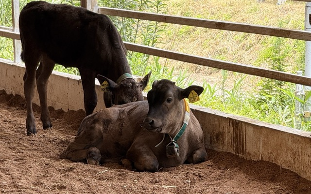
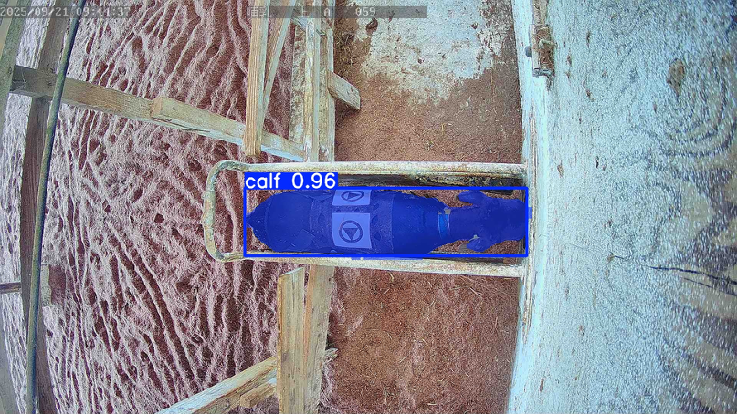

## 研究について

**カメラで撮影した画像から、AIを使って仔牛の体重を推定する研究**をしています。

仔牛の体重は、順調に成長しているか、健康に問題がないかを知るための大切な情報です。しかし、体重計で測るには人手や時間がかかり、仔牛を移動させる必要もあるため、毎日測定するのは簡単ではありません。

そこで、牛舎に設置したカメラの画像から、**仔牛に触れることなく体重を推定する仕組み**を作ろうとしています。将来的には、日々の体重の変化を記録し、仔牛の健康管理に役立てることを目指しています。

## 主なアプローチ

牛舎の天井に設置したカメラで仔牛を撮影し、画像の中から仔牛が写っている部分をAIで見つけます。そして、その部分の大きさなどを手がかりに体重を推定します。

具体的には、次のような流れで研究を進めています。

1. **画像を集める**：牛舎のカメラで撮影した仔牛の画像を用意します。
2. **仔牛の部分を見つける**：AIを使って、画像の中から仔牛が写っている部分を取り出します。
3. **体重を予測する**：取り出した部分の面積などを使い、体重を予測するモデルを作ります。

これまでの実験では、**体重が約105 kg以下の仔牛**について、実際の体重と予測した体重の差が平均約**4.6 kg**という結果が得られました。

一方で、仔牛の体が柵と重なって見えると、AIが仔牛の部分をうまく見つけられないことがあります。現在は、画像から奥行きの情報を推定する技術なども取り入れながら、より安定して体重を予測できる方法を検討しています。

## メッセージ

この研究は、共同獣医学部を中心とした共同研究プロジェクトの一環として進めています。**実際の畜産現場で困っていることを、AIや画像解析の技術を使って解決しようとする点**にやりがいを感じています。

実際の牛舎で撮影された画像を扱うため、思いどおりにいかないこともありますが、異なる分野の方々と協力しながら研究を進められることも、この研究の面白さの一つです。将来、現場で役立つ仕組みにできるよう取り組んでいます。
