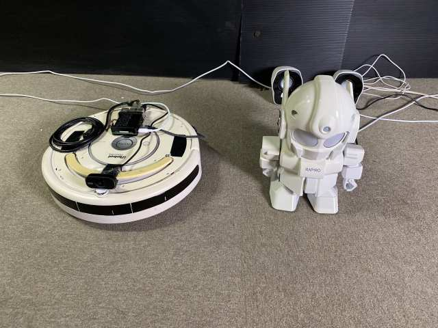

## 研究について

近年、ロボットの活用が広がっており、単体での利用だけでなく、複数のロボットが連携する場面も増えています。また、産業分野だけでなく、エンターテインメント分野での活用も注目されています。

その一例として、ロボット同士が掛け合いを行う「ロボット漫才」があり、私はこれを題材に研究しています。

本研究では、ロボット漫才の面白さや完成度の向上を目指し、実際のロボットを用いた動作制御や実演を通して、さまざまな検討を行っています。

## 主なアプローチ

- **ロボットの動作制御**  
  ロボットの移動や回転など、さまざまな動作を制御し、漫才の演出に活用しています。

- **画像認識による状況把握**  
  カメラを用いた画像認識により、ロボットの周囲の状況を把握する仕組みを検討しています。

- **実験による評価と検証**  
  実際にロボットを用いた実験を行い、ロボット漫才の面白さや完成度の向上に向けた評価を行っています。

## メッセージ

私は、自分の好きなことを題材に、先生方と相談しながら研究テーマを決定しました。

自分で研究テーマを決めることは、与えられたテーマに取り組む場合と比べて大変なことも多いですが、その分、自分の興味や関心を活かして主体的に研究に取り組めると考えています。

研究を進める中では、思い通りにいかないことや困難に直面することもあります。しかし、学生として研究に取り組むうえで大切なのは、研究に対する興味や意欲を持ち続け、前向きに取り組むことだと考えています。
