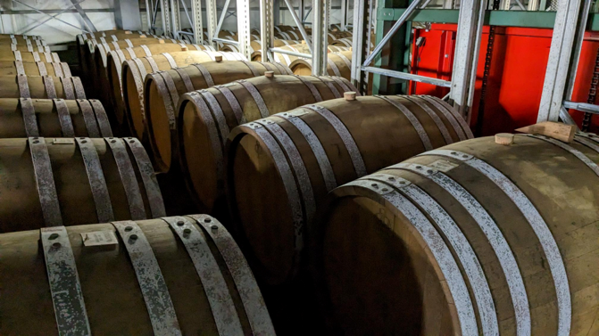

## 研究について

焼酎を樽で熟成させると、蒸発によって液面が少しずつ下がる。酒造現場では、樽の栓を開け、寸棒と呼ばれる目盛り付きの棒で液面の高さを測る。多くの樽を管理する現場では、一本ずつ開けて測る作業に時間がかかる。

そこで、レーザ測距センサーを組み込んだ栓を試作し、樽を閉じたまま液面までの距離を自動で記録する方法を研究している。酒蔵での約1週間の連続計測では、センサーで捉えた液面の変化が、寸棒で確認した変化よりも大きく出た。この差を手がかりに、装置の傾きや測定値のばらつき、温湿度などの影響を調べ、約2 mmの液面変化を安定して捉えることを目指している。

## 主なアプローチ

- **傾きによる誤差を補正する。**
  栓に組み込んだ傾きセンサーで装置の姿勢を測り、斜めに測った距離から液面までの鉛直距離を求める。
- **繰り返し測って、ばらつきを抑える。**
  同じ時点で複数回測り、他の測定値から大きく離れた値を除いて平均する。
- **室内と酒蔵で精度を確かめる。**
  室内の水槽では、液面を一定に保ったときに測定値がどの程度変動するかを調べる。酒蔵では、連続計測で得た液面の変化量を、寸棒による測定結果と比較する。

## メッセージ

酒蔵の担当者が、樽を一本ずつ開ける前に、どの樽の液面がいつ、どのくらい下がったかを確認できるようにしたい。測定した距離を時刻とともに記録し、樽ごとの液面の推移を一覧で見られる仕組みにつなげたいと考えている。
